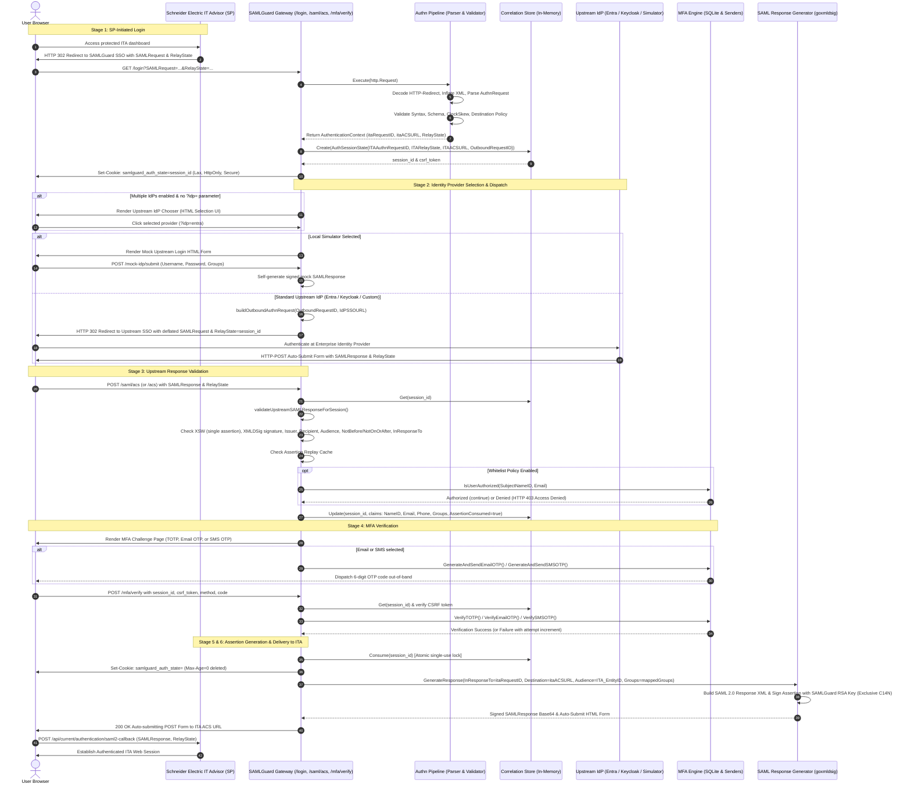

# SAMLGuard – Phase 3.1: End-to-End SAML Authentication Flow Audit Report

**Date:** November 20, 2026  
**Status:** Completed (READ-ONLY Audit)  
**Target:** SAMLGuard Go Microservice  
**Scope:** Complete Authentication Journey: Schneider Electric IT Advisor (ITA) &rarr; SAMLGuard Gateway &rarr; Upstream Identity Provider &rarr; MFA Engine &rarr; SAML Assertion &rarr; IT Advisor  

---

## 1. Executive Summary

A comprehensive, read-only architectural and security audit of the SAMLGuard authentication pipeline was conducted. The audit traced the complete lifecycle of a user authentication request from its origin in Schneider Electric IT Advisor (ITA), through SAMLGuard's request pipeline, upstream identity federation, second-factor MFA verification, assertion generation, and final delivery to ITA.

### Key Audit Conclusions:
1. **Core Authentication & MFA Pipeline (IMPLEMENTED & ROBUST):**
   - The central proxy authentication flow is functional, coherent, and secure.
   - Upstream SAML assertion validation enforces strict XML digital signature validation (`goxmldsig`), rejects XML Signature Wrapping (XSW) attacks, rejects duplicate XML IDs, verifies timestamps (`NotBefore`/`NotOnOrAfter`), and enforces `InResponseTo` transaction correlation.
   - Second-factor verification (MFA) is strictly mandatory: SAML assertions are emitted **exclusively** after successful second-factor validation via an atomic session consumption mechanism.
   - All three MFA verification channels—Authenticator App (TOTP RFC 6238), Email OTP (SMTP), and SMS OTP (8 hardware/cloud gateway profiles)—are fully implemented with rate limiting, brute-force lockout, single-use token consumption, and cryptographic secrecy (AES-GCM encrypted secrets and HMAC-SHA256 hashed challenge codes).
2. **Architectural Intent (Stateless Proxy):**
   - SAMLGuard functions as a transparent, stateless MFA proxy gateway. Persistent end-user session management, idle timeouts, and access authorization are owned downstream by Schneider Electric IT Advisor. SAMLGuard clears its transient authentication state immediately upon assertion delivery.
3. **Key Deficiencies & Architectural Limitations Identified:**
   - **Inbound AuthnRequest Signatures:** Signature verification for inbound AuthnRequests from Service Providers is currently stubbed to fail-closed (`errors.New("signature verification is not implemented")`). While standard HTTP-Redirect unsigned requests work when `AllowUnsigned = true`, signed requests from SPs are rejected.
   - **SAML Single Logout (SLO):** Although an SLO URL is defined in configuration and metadata (`/logout`), no HTTP handler or routing logic is registered in `cmd/samlguard/main.go`. SLO is **NOT IMPLEMENTED**.
   - **Encrypted Assertions:** SAMLGuard does not support decrypting `<saml:EncryptedAssertion>` elements from upstream IdPs. Upstream IdPs must be configured to emit unencrypted assertions.
   - **Outbound AuthnRequest Signing:** AuthnRequests redirected to upstream IdPs are unsigned XML. IdPs that enforce `WantAuthnRequestsSigned="true"` will reject the request.
   - **Clustering / High-Availability:** Replay detection and correlation state stores are held in local process memory, requiring sticky sessions if deployed behind a multi-node load balancer.

---

## 2. Actual Authentication Architecture

SAMLGuard acts as a dual-role SAML 2.0 gateway:
1. **To Schneider Electric IT Advisor (Downstream):** Acts as a SAML 2.0 Identity Provider (IdP) that authenticates users, enforces MFA, generates signed assertions, and posts them to ITA's Assertion Consumer Service (ACS).
2. **To Upstream Identity Providers (Upstream):** Acts as a SAML 2.0 Service Provider (SP) that issues AuthnRequests and consumes upstream SAML assertions.

```
+-------------------------------------------------------------------------------------------------------------------+
|                                            SAMLGUARD DUAL-ROLE GATEWAY                                            |
|                                                                                                                   |
|  [ Downstream ITA ]                   [ SAMLGuard Gateway ]                       [ Upstream IdP ]                |
|      (SP Role)                       (IdP Role <-> SP Role)                          (IdP Role)                   |
|                                                                                                                   |
|          | --- 1. AuthnRequest ------------> |                                            |                       |
|          |                                   | --- 2. Outbound AuthnRequest ------------> |                       |
|          |                                   |                                            | (Entra / Keycloak /   |
|          |                                   | <--- 3. SAMLResponse (Signed Assertion) -- |  Custom / Simulator)  |
|          |                                   |                                                                    |
|          |                        [ 4. MFA Verification ]                                                         |
|          |                        (TOTP / Email / SMS)                                                            |
|          |                                   |                                                                    |
|          |                                   | [ 5. SAML Assertion Generator ]                                    |
|          |                                   | (Signs assertion with SAMLGuard RSA Key)                           |
|          |                                   |                                                                    |
|          | <--- 6. HTTP-POST SAMLResponse -- |                                                                    |
|          |      to ITA Callback ACS          |                                                                    |
+-------------------------------------------------------------------------------------------------------------------+
```

---

## 3. End-to-End Sequence Diagram

The diagram below reflects the **actual code implementation** in `internal/gateway/handler/handler.go`, `internal/gateway/pipeline/default.go`, `internal/mfa/service.go`, and `internal/gateway/saml_response.go`.



---

## 4. Detailed Audit of All Seven Stages

### Stage 1 – Service Provider Initiated Login

- **Entrypoints:** `GET /login`, `POST /login`, `GET /saml/sso` (`cmd/samlguard/main.go:340,350`).
- **Handler Implementation:** `internal/gateway/handler/handler.go:426` (`HandleSSO`).
- **Pipeline Implementation:** `internal/gateway/pipeline/default.go:81` (`Execute`).

#### Audit Findings:
1. **Binding & Decoding:**
   - Supports both `HTTP-Redirect` (deflated Base64 query parameter `SAMLRequest`) and `HTTP-POST` (Base64 form body `SAMLRequest`) via `internal/gateway/binding/binding.go` and `decoder.go`.
2. **Parsing & Structural Well-Formedness:**
   - Parsed via `internal/gateway/parser/secure.go:13` (`SecureCrewjamParser`).
   - Uses Go's standard `encoding/xml` parser which disables external DTD entity loading by default, mitigating traditional XXE.
   - Capped by `DefaultSyntaxValidator.MaxXMLSize` and validated for UTF-8 conformity.
3. **Issuer & Destination Validation:**
   - `DefaultSchemaValidator` (`internal/gateway/validator/concrete.go:58`) enforces non-empty `<saml:Issuer>`.
   - `DefaultPolicyValidator` (`internal/gateway/validator/concrete.go:155`) checks the `Destination` attribute against the configured SAMLGuard Entity ID / SSO endpoint.
4. **ACS URL Allowlist Enforcement:**
   - In `handler.go:469`, if the inbound AuthnRequest specifies an `AssertionConsumerServiceURL`, SAMLGuard verifies it against `h.cfg.IsAllowedDownstreamACSURL(itaACSURL)`.
   - If untrusted, the request is terminated immediately (`400 Bad Request: security violation: AssertionConsumerServiceURL is not in configured downstream allowlist`).
   - If omitted by ITA, it safely defaults to `h.cfg.SAML.ACSURL`.
5. **Request ID Correlation & State Initialization:**
   - An outbound correlation ID (`SG_<uuid>`) is minted.
   - A correlation record (`AuthSessionState`) is created in `h.correlationStore` with a 15-minute TTL.
   - An HTTP-only, SameSite=Lax cookie (`samlguard_auth_state`) is issued to track the browser through upstream redirects.
6. **Inbound AuthnRequest Signature Gap:**
   - `DefaultSignatureValidator.ValidateSignature` (`internal/gateway/validator/concrete.go:20-32`) explicitly fails-closed on signed requests:
     ```go
     if ctx.SecurityFlags.IsSigned {
         return errors.New("signature verification is not implemented: fail-closed security boundary enforced")
     }
     ```
   - *Status:* Unsigned AuthnRequests via HTTP-Redirect work as expected when `AllowUnsigned = true`. However, signed AuthnRequests from SPs are rejected.

---

### Stage 2 – Identity Provider Selection

- **Handler Implementation:** `internal/gateway/handler/handler.go:509-596` (`HandleSSO`).
- **Profiles Implementation:** `internal/config/config.go` (`IdPProfiles`).

#### Audit Findings:
1. **Multi-IdP Selection UI:**
   - If more than one upstream IdP is enabled in `h.cfg.SAML.IdPProfiles` and no `?idp=` query parameter is supplied, `renderUpstreamIdPChooser()` renders an enterprise selection landing page.
   - If only one IdP is active, SAMLGuard auto-selects it and bypasses the chooser screen.
2. **Provider Specifics:**
   - **Local Simulator (`simulator`):** Renders mock login (`/mock-idp/submit`). **Strictly blocked in production** (`handler.go:561`: returns `403 Forbidden`).
   - **Microsoft Entra ID (`entra`), Keycloak (`keycloak`), Custom IdP (`custom`):** Resolves EntityID, SSO URL, and X.509 cert from profile.
3. **Outbound AuthnRequest Generation:**
   - Generates SAML 2.0 AuthnRequest in `buildOutboundAuthnRequest()` (`handler.go:616`).
   - Formats `ID="SG_<uuid>"`, `IssueInstant`, `Destination`, `AssertionConsumerServiceURL="<gateway_acs>"`, `ProtocolBinding="urn:oasis:names:tc:SAML:2.0:bindings:HTTP-POST"`, and `NameIDPolicy`.
   - Compresses via DEFLATE (RFC 1951), encodes in Base64, appends `RelayState=<session_id>`, and issues an `HTTP 302 Found` redirect.
4. **Outbound Signing & Binding Limitations:**
   - Only `HTTP-Redirect` binding is implemented for outbound AuthnRequests. `HTTP-POST` outbound binding is NOT IMPLEMENTED.
   - Cryptographic signing of outbound AuthnRequests is NOT IMPLEMENTED (sent unsigned).

---

### Stage 3 – Upstream SAML Response Validation

- **Entrypoints:** `POST /saml/acs`, `POST /acs` (`cmd/samlguard/main.go:341,352`).
- **Handler Implementation:** `internal/gateway/handler/handler.go:991` (`HandleACS`).
- **Validation Engine:** `internal/gateway/handler/handler.go:647` (`validateUpstreamSAMLResponseForSession`).

#### Audit Findings:
1. **XML Signature Verification (`XMLDSig`):**
   - Validated using `github.com/russellhaering/goxmldsig`.
   - Loads the exact upstream IdP public certificate configured in the session profile (`loadIDPCertStoreFromPath(certFile)`), falling back to the gateway combined store.
   - Accepts signatures on either `<saml:Assertion>` or `<samlp:Response>`. Unsigned responses are rejected.
2. **XML Signature Wrapping (XSW) Defense:**
   - In `handler.go:674`: `doc.FindElements("//Assertion")`. If more than one assertion element exists, the request is immediately rejected (`401 Unauthorized: multiple Assertion elements detected`).
   - Rejects duplicate XML `@ID` attributes across the document (`handler.go:688`).
3. **Entity ID / Issuer Verification:**
   - Strictly compares `<saml:Issuer>` against the session's configured `UpstreamEntityID`. Mismatched issuers are rejected (`handler.go:756`).
4. **InResponseTo Transaction Correlation:**
   - Verifies that `InResponseTo` on `<samlp:Response>` or `<saml:SubjectConfirmationData>` strictly matches the `OutboundRequestID` recorded in `AuthSessionState` (`handler.go:768`).
   - Unsolicited IdP-initiated responses are rejected (`handler.go:775`).
5. **SubjectConfirmation & Recipient Matching:**
   - Enforces that `<saml:SubjectConfirmationData Recipient="...">` matches SAMLGuard's Gateway ACS location (`handler.go:798`).
6. **AudienceRestriction Verification:**
   - Verifies `<saml:Audience>` against SAMLGuard's `cfg.SAML.EntityID` and `cfg.SAML.AllowedAudiences` (`handler.go:825`).
7. **Temporal Conditions & Clock Skew:**
   - Validates `NotBefore` and `NotOnOrAfter` on both `<SubjectConfirmationData>` and `<Conditions>` with a 5-minute skew buffer (`handler.go:830-880`).
8. **Assertion Replay Cache:**
   - Upon successful signature and claim validation, the assertion's unique `ID` is recorded in `h.getAssertionReplay()` (`handler.go:946`). Replayed assertions are rejected.
9. **User Whitelist Policy:**
   - If `cfg.ITA.EnforceUserWhitelist` is enabled, the subject's NameID or Email is checked against the ITA-synced database (`handler.go:1054`). Unregistered users are blocked with an Access Denied screen.
10. **Encrypted Assertions Gap:**
    - `<saml:EncryptedAssertion>` elements are NOT decrypted. Upstream IdPs must send unencrypted assertions.

---

### Stage 4 – MFA Verification

- **Entrypoints:** `POST /mfa/verify`, `POST /mfa/resend`, `POST /mfa/re-enroll` (`cmd/samlguard/main.go:357-359`).
- **Handler Implementation:** `internal/gateway/handler/handler.go:1145` (`HandleMFAVerify`).
- **MFA Service:** `internal/mfa/service.go`.
- **Database Storage:** `internal/mfa/storage.go` (SQLite with serialized transactions).

#### A. Authenticator App (TOTP)
- **RFC 6238 Standard:** Implemented in `internal/mfa/service.go:407` (`validateRFC6238TOTP`) and `service.go:427` (`generateHOTP`). Uses 30-second time-steps and HMAC-SHA1.
- **Secret Provisioning:** Generates 20-byte cryptographically secure random secrets, base32 encoded. Stored encrypted at rest using AES-256-GCM (`storage.go:986`).
- **Replay Protection:** Tracks `last_used_timestep` in `mfa_secrets` table. Any token generated in the same or earlier time-step is rejected (`storage.go:484`).
- **Lockout:** Enforces 5 failed attempts lockout with escalating backoff (`storage.go:510`).

#### B. Email OTP (SMTP)
- **Code Generation:** 6-digit numeric OTP generated via `crypto/rand.Int` (`internal/mfa/service.go:571`).
- **Digest Storage:** Plaintext OTP is NEVER stored in database. Stores `HMAC-SHA256(pepper, code)` in `mfa_email_otp` (`storage.go:591`).
- **Delivery Engine:** `internal/mfa/smtp.go` supports Plain, STARTTLS, and direct TLS. Uses dual HTML / Plaintext templates.
- **Controls:** 5-minute expiry, 60-second resend cooldown, 5 max verification attempts, and atomic single-use consumption (`storage.go:631`).

#### C. SMS OTP (Cloud & Hardware Gateways)
- **Code Generation & Secrecy:** Same secure numeric generator and HMAC-SHA256 peppered digest as Email OTP (`mfa_sms_otp` table).
- **Supported Gateways:** Implemented in `internal/mfa/sms.go:142` (`dispatchByProvider`):
  1. *Twilio* (REST API)
  2. *iSMS* (HTTP GET/POST)
  3. *SendQuick* (HTTP Appliance API)
  4. *SMSEagle* (Hardware Gateway API)
  5. *MultiTech* (MultiConnect Cell API)
  6. *Teltonika* (RUT/TRB Industrial Cellular Router)
  7. *Vonage* (REST API)
  8. *Custom HTTP* (Configurable URL, method, headers, JSON/form template)
- **Phone Resolution:** Extracted from upstream claims (`phone`, `mobile`, `telephonenumber`) or resolved from `authorized_users` table in SQLite (`LookupUserPhone`).

#### MFA Enforcement & Bypass Protection
- **No Direct Assertion Endpoint:** There is no route in SAMLGuard that generates a SAML assertion without completing `POST /mfa/verify`.
- **Transaction Binding:** The MFA verification request must supply a valid `session_id` and matching `csrf_token`. It operates strictly on the `UserIdentityKey` established during Stage 3.
- **Atomic Single-Use Consumption:**
  ```go
  // handler.go:1231
  consumedState, err := h.correlationStore.Consume(sessionID)
  ```
  Once verified, `correlationStore.Consume()` atomically sets `Consumed = true`. Any replay of the session ID fails with `409 Conflict: authentication state already consumed`.

---

### Stage 5 – SAML Assertion Generation

- **Implementation:** `internal/gateway/saml_response.go:124` (`GenerateResponse`).
- **XML Construction:** `github.com/beevik/etree`.
- **XMLDSig Signing:** `github.com/russellhaering/goxmldsig`.

#### Audit Findings:
1. **Attributes & Identity Claims:**
   - `Subject/NameID`: Set to `consumedState.SubjectNameID` (Format: `persistent`).
   - Claims emitted:
     - `.../claims/name`: SubjectNameID
     - `.../claims/emailaddress`: UserEmail
     - `.../claims/CommonName`: DisplayName
     - `.../claims/Group`: Mapped groups
2. **Group & Role Mapping:**
   - Translated via `resolveMappedGroups()` (`saml_response.go:296`) using `cfg.SAML.GroupMapping`.
   - Maps upstream claims (e.g. Entra Security Groups / Keycloak Roles) to Schneider IT Advisor roles (`Admin`, `Operator`, `Viewer`).
   - If unmapped, falls back to `cfg.SAML.DefaultGroups` if configured.
3. **Assertion InResponseTo Correlation:**
   - In `saml_response.go:171,201`: `resp.CreateAttr("InResponseTo", req.InResponseTo)` and `subjConfData.CreateAttr("InResponseTo", req.InResponseTo)`.
   - **Critical:** Populated with `consumedState.ITAAuthnRequestID`, ensuring ITA can correlate the assertion with its original AuthnRequest.
4. **Digital Signature:**
   - Signs the `<saml:Assertion>` element using RSA-SHA256 and W3C Exclusive XML Canonicalization (C14N 1.0).
   - Certificate included in `<ds:KeyInfo>`.
   - Signed using SAMLGuard's private key (`cfg.SAML.KeyFile`).
5. **Assertion Validity Window:**
   - Emits `NotBefore = now - 1 hour` and `NotOnOrAfter = now + 1 hour` (`saml_response.go:159-160`).
   - While accommodating VMware/Hyper-V hypervisor clock skew in offline enterprise data centers, a 2-hour window is broader than the standard 5-minute window.

---

### Stage 6 – Assertion Delivery to ITA

- **Implementation:** `internal/gateway/saml_response.go:277-292` & `internal/gateway/handler/handler.go:1286`.
- **Binding:** HTTP-POST binding with auto-submitting HTML form.

#### Audit Findings:
1. **Separation of ACS URLs:**
   - Inbound AuthnRequest from ITA specifies ITA's ACS URL (e.g. `https://ita.example.com/api/current/authentication/saml2-callback`).
   - SAMLGuard stores this in `state.ITAACSURL`.
   - Gateway's own ACS (`https://samlguard.../saml/acs`) is used solely for upstream IdP callbacks.
   - The two endpoints are never confused in the codebase.
2. **Auto-Submit POST Form:**
   - Generates clean, standards-compliant HTML:
     ```html
     <body onload="document.forms[0].submit()">
     <form method="POST" action="<ITA_ACS_URL>">
       <input type="hidden" name="SAMLResponse" value="<Base64_Response>"/>
       <input type="hidden" name="RelayState" value="<ITA_RelayState>"/>
     </form>
     ```
   - Preserves ITA's original `RelayState` verbatim.
   - Includes `<noscript>` fallback button for non-JS browsers.

---

### Stage 7 – Session, Logout and Expiration

- **Handler Implementation:** `internal/gateway/handler/handler.go:1239` & `internal/gateway/handler/admin.go:503`.

#### Audit Findings:
1. **End-User Session Lifecycle (Stateless Gateway Design):**
   - SAMLGuard explicitly clears the `samlguard_auth_state` cookie (`Max-Age = -1`) immediately upon emitting the assertion to ITA (`handler.go:1242`).
   - SAMLGuard maintains **no long-term user session**. All user session duration, concurrent session limits, and inactivity timeouts are governed downstream by IT Advisor.
2. **Transient Correlation Session Expiration:**
   - Handled in `CorrelationStore` (`internal/gateway/handler/state.go`).
   - Default TTL is 15 minutes.
   - Expired or consumed sessions are cleaned up by a background goroutine every 2 minutes.
3. **Single Logout (SLO) Status – NOT IMPLEMENTED:**
   - Configuration defines `cfg.SAML.SLOURL = "https://...:18080/logout"`.
   - **Critical Gap:** In `cmd/samlguard/main.go`, no route is registered for `/logout` or `/saml/slo`.
   - If an administrator or user triggers logout in ITA, the request to `/logout` returns **HTTP 404 Not Found**.
   - Neither downstream nor upstream SLO coordination takes place.

---

## 5. MFA Provider Implementation Matrix

| Capability | Authenticator App (TOTP) | Email OTP (SMTP) | SMS OTP (Gateways) |
| :--- | :---: | :---: | :---: |
| **Specification / Protocol** | RFC 6238 / RFC 4226 | RFC 5321 (SMTP / STARTTLS / TLS) | HTTP REST / Appliance API |
| **Code Length / Format** | 6-digit numeric (dynamic truncation) | 6-digit numeric (`crypto/rand`) | 6-digit numeric (`crypto/rand`) |
| **Secret Storage at Rest** | AES-256-GCM encrypted in SQLite | Ephemeral (HMAC-SHA256 digest) | Ephemeral (HMAC-SHA256 digest) |
| **Server Pepper Secret** | N/A (Shared HMAC secret) | 32-byte server pepper applied | 32-byte server pepper applied |
| **Token Lifetime** | 30-second time-step (&plusmn;1 step skew) | 5 minutes (configurable) | 5 minutes (configurable) |
| **Resend Cooldown** | N/A (Time-step based) | 60 seconds (configurable) | 60 seconds (configurable) |
| **Replay Protection** | `last_used_timestep` tracked | Marked `consumed = 1` in DB | Marked `consumed = 1` in DB |
| **Attempt Limit / Lockout** | 5 attempts &rarr; Lockout with backoff | 5 max attempts &rarr; Token invalid | 5 max attempts &rarr; Token invalid |
| **User Identity Binding** | `upstreamEntityID\|NameID` | `upstreamEntityID\|NameID` | `upstreamEntityID\|NameID` |
| **Enrollment Flow** | QR Code + Manual Base32 Key | Automatic to user email claim | Resolved from claim or DB phone |
| **Self-Service Re-enroll** | Implemented (requires auth factor) | N/A (Address from claim) | N/A (Admin / Sync managed) |
| **Hardware / Vendor Support**| Google/MS Authenticator, 1Password | Any standard SMTP (Office365, etc.) | Twilio, iSMS, SendQuick, SMSEagle, MultiTech, Teltonika, Vonage, Custom |
| **Overall Status** | **IMPLEMENTED** | **IMPLEMENTED** | **IMPLEMENTED** |

---

## 6. Security Review & Vulnerability Assessment

### Findings Summary Table

| ID | Severity | Finding Title | Affected File & Function | Impact Summary |
| :---: | :---: | :--- | :--- | :--- |
| **SEC-01** | **HIGH** | Inbound AuthnRequest signature verification not implemented (fails-closed) | `internal/gateway/validator/concrete.go:20`<br>`DefaultSignatureValidator.ValidateSignature` | Signed AuthnRequests from SPs are rejected. Unsigned requests work when `AllowUnsigned=true`. |
| **SEC-02** | **HIGH** | SAML Single Logout (SLO) endpoint missing from routing table | `cmd/samlguard/main.go:340-368`<br>`main.SetupApp` | Calling configured SLO URL returns 404; logout from ITA leaves upstream IdP session active. |
| **SEC-03** | **MEDIUM** | Upstream Encrypted Assertions (`<EncryptedAssertion>`) not supported | `internal/gateway/handler/handler.go:674`<br>`validateUpstreamSAMLResponseForSession` | Responses with encrypted assertions fail validation. Upstream IdPs must be configured unencrypted. |
| **SEC-04** | **MEDIUM** | In-memory correlation & replay storage lacks clustering synchronization | `internal/gateway/handler/state.go:44`<br>`CorrelationStore` | Load-balanced multi-node deployments without session affinity will experience correlation failures. |
| **SEC-05** | **MEDIUM** | Generous 1-hour clock skew window on emitted SAML assertions | `internal/gateway/saml_response.go:159`<br>`ResponseGenerator.GenerateResponse` | Broad 2-hour assertion validity window exceeds industry recommendation of 5-10 minutes. |
| **SEC-06** | **LOW** | Outbound AuthnRequests to upstream IdPs are unsigned | `internal/gateway/handler/handler.go:616`<br>`buildOutboundAuthnRequest` | Upstream IdPs requiring `WantAuthnRequestsSigned="true"` will reject redirect requests. |
| **SEC-07** | **LOW** | Dynamic HTTP metadata resolution fails-closed by design | `internal/gateway/resolver/metadata.go:75`<br>`HTTPMetadataProvider.FetchMetadata` | Federation metadata URLs cannot be dynamically fetched; requires manual EntityID/SSO URL config. |
| **SEC-08** | **INFO** | Mock/Simulator IdP is strictly forbidden in production mode | `internal/gateway/handler/handler.go:561`<br>`HandleSSO` | Verified security safeguard preventing test bypass in live production environments. |

---

### Detailed Findings & Technical Evidence

#### SEC-01: Inbound AuthnRequest Signature Verification Stubbed
- **Severity:** HIGH
- **Component:** AuthnRequest Validation Pipeline
- **Exact Location:** `internal/gateway/validator/concrete.go:20-32`
- **Code Evidence:**
  ```go
  func (v *DefaultSignatureValidator) ValidateSignature(ctx *model.AuthenticationContext) error {
      if ctx == nil {
          return errors.New("authentication context is nil")
      }
      if v.AllowUnsigned && !ctx.SecurityFlags.IsSigned {
          return nil
      }
      if ctx.SecurityFlags.IsSigned {
          return errors.New("signature verification is not implemented: fail-closed security boundary enforced")
      }
      ctx.SecurityFlags.IsSigned = false
      return errors.New("signature verification is not implemented: fail-closed security boundary enforced")
  }
  ```
- **Potential Impact:** If IT Advisor or another Service Provider is configured to sign outbound AuthnRequests for integrity or non-repudiation, SAMLGuard rejects them with a 400 Bad Request error.
- **Recommended Remediation (Phase 3.2):** Implement X.509 signature verification against the SP's public certificate when `IsSigned == true`.

---

#### SEC-02: SAML Single Logout (SLO) Endpoint Missing from Routing Table
- **Severity:** HIGH
- **Component:** HTTP Routing / Gateway Handlers
- **Exact Location:** `cmd/samlguard/main.go:340-368`
- **Code Evidence:**
  Configuration sets `cfg.SAML.SLOURL = "https://...:18080/logout"`, and `HandleAdminLogout` is mapped at `POST /admin/logout`. However, neither `/logout` nor `/saml/slo` is mapped for SAML user sessions.
- **Potential Impact:** Initiating Single Logout from Schneider Electric IT Advisor results in an HTTP 404 error. The upstream IdP session remains open, allowing subsequent users on a shared terminal to access ITA without re-authenticating.
- **Recommended Remediation (Phase 3.2):** Register a dedicated `GET/POST /logout` route that accepts `LogoutRequest`, terminates any active transient state, and coordinates with upstream IdP logout endpoints.

---

#### SEC-03: Upstream Encrypted Assertions Not Supported
- **Severity:** MEDIUM
- **Component:** Upstream SAML Response Validator
- **Exact Location:** `internal/gateway/handler/handler.go:674-680`
- **Code Evidence:**
  ```go
  allAssertions := doc.FindElements("//Assertion")
  if len(allAssertions) > 1 {
      return nil, errors.New("security violation: multiple Assertion elements detected (signature wrapping attempt)")
  }
  if len(allAssertions) == 0 {
      return nil, errors.New("missing Assertion element in SAMLResponse")
  }
  ```
- **Potential Impact:** If an upstream administrator toggles "Encrypt Assertions" in Microsoft Entra ID or Keycloak, SAMLGuard encounters 0 `<Assertion>` elements and rejects the response.
- **Recommended Remediation (Phase 3.2):** Add support for decrypting `<xenc:EncryptedData>` within `<saml:EncryptedAssertion>` using SAMLGuard's private key before assertion processing.

---

#### SEC-04: In-Memory Correlation & Replay Storage (Clustering Limitation)
- **Severity:** MEDIUM
- **Component:** Session Correlation & Replay Detector
- **Exact Location:** `internal/gateway/handler/state.go:44` (`CorrelationStore`) and `pkg/replay/replay.go` (`MemoryReplayDetector`)
- **Code Evidence:**
  Session states are stored in Go map structures protected by `sync.RWMutex`.
- **Potential Impact:** In high-availability deployments with multiple SAMLGuard instances behind a round-robin load balancer, a user whose login starts on Node 1 but returns from Entra ID to Node 2 will fail authentication because Node 2 lacks Node 1's memory state.
- **Recommended Remediation (Phase 3.2):** Document the requirement for sticky sessions (cookie affinity) at the load balancer, or introduce a shared state store (e.g. SQLite database table with automatic cleanup).

---

#### SEC-05: Generous 1-Hour Clock Skew Window on Emitted Assertion
- **Severity:** MEDIUM
- **Component:** SAML Response Generator
- **Exact Location:** `internal/gateway/saml_response.go:159-160, 209-210`
- **Code Evidence:**
  ```go
  notBefore := now.Add(-1 * time.Hour).Format(samlTimeFormat)
  notOnOrAfter := now.Add(1 * time.Hour).Format(samlTimeFormat)
  ```
- **Potential Impact:** An assertion emitted to ITA remains technically valid for up to 2 hours. While designed to prevent VM hypervisor clock drift issues in isolated data center networks, it exceeds standard enterprise security profiles (typically 5 to 10 minutes).
- **Recommended Remediation (Phase 3.2):** Make the assertion validity duration configurable in `config.yaml` with a default of 5-10 minutes.

---

## 7. Existing Test Coverage Audit

### Test Suite Execution Results

Automated test execution across all packages was performed:
```bash
go test -count=1 ./cmd/... ./internal/... ./pkg/...
```

**Results:**
- `cmd/samlguard`: **PASS** (6.07s)
- `internal/config`: **PASS** (0.64s)
- `internal/federation/metadata`: **PASS** (0.33s)
- `internal/gateway`: **PASS** (0.41s)
- `internal/gateway/binding`: **PASS** (0.40s)
- `internal/gateway/capture`: **PASS** (1.53s)
- `internal/gateway/handler`: **PASS** (10.09s)
- `internal/gateway/pipeline`: **PASS** (0.41s)
- `internal/gateway/resolver`: **PASS** (0.38s)
- `internal/gateway/validator`: **PASS** (0.41s)
- `internal/ita`: **PASS** (0.70s)
- `internal/mfa`: **PASS** (3.28s)
- `internal/network`: **PASS** (0.35s)
- `pkg/config`: **PASS** (0.37s)
- `pkg/middleware`: **PASS** (0.39s)
- `pkg/ratelimiter`: **PASS** (1.47s)
- `pkg/replay`: **PASS** (0.23s)

**Overall Test Suite Result:** **100% PASS (Zero Failures)**

### Static Analysis (`go vet`)
```bash
go vet ./cmd/... ./internal/... ./pkg/...
```
**Result:** **0 warnings, clean execution**

---

### Test Coverage Matrix by Stage

| Authentication Stage | Existing Test Coverage | Primary Test Files | Coverage Quality | Gaps / Untested Areas |
| :--- | :--- | :--- | :---: | :--- |
| **Stage 1: SP AuthnRequest** | Decoders, syntax, schema, clock skew, destination, untrusted ACS rejection | `cmd/samlguard/e2e_test.go`<br>`internal/gateway/pipeline/pipeline_test.go`<br>`internal/gateway/validator/validator_test.go` | **High** | Inbound signed AuthnRequests are not tested (unsupported). |
| **Stage 2: IdP Selection** | Multi-IdP chooser UI, Entra redirect, Keycloak profile resolution, simulator form | `internal/gateway/handler/handler_test.go`<br>`cmd/samlguard/e2e_test.go` | **High** | Outbound AuthnRequest signature generation is not tested (unsupported). |
| **Stage 3: Upstream Response** | XMLDSig validation, rogue certs, tampered signatures, issuer mismatch, recipient mismatch, InResponseTo, XSW, replay | `cmd/samlguard/e2e_test.go`<br>`internal/gateway/handler/handler_test.go` | **Comprehensive** | Encrypted assertions are not tested (unsupported). |
| **Stage 4: MFA Verification** | TOTP enrollment, verification, replay lock, brute force lockout, Email OTP send/verify, SMS gateways (8 providers), dummy OTP rejection in prod | `cmd/samlguard/e2e_test.go`<br>`internal/mfa/service_test.go`<br>`internal/mfa/sms_test.go`<br>`internal/gateway/handler/handler_test.go` | **Comprehensive** | Live end-to-end SMS transmission with physical SIM hardware (simulated via HTTP mock servers). |
| **Stage 5: Assertion Generation** | Response XML generation, Exclusive C14N, XMLDSig enveloped signature, attribute mapping, group mapping, AuthnContext | `internal/gateway/saml_response_test.go`<br>`cmd/samlguard/e2e_test.go` | **High** | Multi-attribute encryption (unsupported). |
| **Stage 6: Delivery to ITA** | HTML auto-submit form generation, RelayState preservation, destination matching | `internal/gateway/saml_response_test.go`<br>`cmd/samlguard/e2e_test.go` | **High** | Real Schneider ITA server automated browser callback verification. |
| **Stage 7: Session & Logout** | Admin login/logout, CSRF tokens, session timeouts, cookie flags | `internal/gateway/handler/admin_test.go` | **Low for SAML Users** | SAML user Single Logout (SLO) has zero tests because route does not exist. |

---

## 8. Implementation Status Matrix

| Stage / Component | Status | Verification Reference | Notes |
| :--- | :---: | :--- | :--- |
| **1. SP-Initiated Login (HTTP-Redirect)** | **IMPLEMENTED** | `internal/gateway/handler/handler.go:426` | Deflated Base64 parsing, schema check, ACS allowlist validation. |
| **1. SP-Initiated Login (HTTP-POST)** | **IMPLEMENTED** | `internal/gateway/binding/binding.go` | Form-encoded Base64 AuthnRequest supported. |
| **1. Inbound AuthnRequest Signature** | **NOT IMPLEMENTED** | `internal/gateway/validator/concrete.go:27` | Fails-closed on signed requests. Works unsigned. |
| **2. Local Simulator IdP** | **IMPLEMENTED** | `internal/gateway/handler/handler.go:560` | Interactive mock form; strictly blocked in production. |
| **2. Microsoft Entra ID Integration** | **IMPLEMENTED** | `internal/gateway/handler/handler.go:576` | Profile resolution, outbound redirect, claim extraction. |
| **2. Keycloak Integration** | **IMPLEMENTED** | `internal/gateway/handler/handler.go:576` | Profile resolution, outbound redirect, claim extraction. |
| **2. Custom SAML 2.0 IdP Integration** | **IMPLEMENTED** | `internal/gateway/handler/handler.go:576` | Profile resolution, outbound redirect, claim extraction. |
| **2. Outbound AuthnRequest Signing** | **NOT IMPLEMENTED** | `internal/gateway/handler/handler.go:616` | Sent unsigned via HTTP-Redirect binding. |
| **2. Outbound AuthnRequest HTTP-POST**| **NOT IMPLEMENTED** | `internal/gateway/handler/handler.go:595` | Only HTTP-Redirect binding is supported. |
| **3. XMLDSig Upstream Signature Check**| **IMPLEMENTED** | `internal/gateway/handler/handler.go:722` | Uses `goxmldsig` with IdP X.509 cert from profile or bundle. |
| **3. XML Signature Wrapping (XSW) Guard**| **IMPLEMENTED** | `internal/gateway/handler/handler.go:674` | Rejects multiple assertions and duplicate XML IDs. |
| **3. Upstream Issuer & Recipient Check**| **IMPLEMENTED** | `internal/gateway/handler/handler.go:741,788` | Rejects mismatched issuers or recipients. |
| **3. InResponseTo Correlation** | **IMPLEMENTED** | `internal/gateway/handler/handler.go:760` | Strictly matches outbound ID; rejects unsolicited responses. |
| **3. Assertion Replay Detection** | **IMPLEMENTED** | `internal/gateway/handler/handler.go:946` | In-memory replay cache tracks assertion IDs. |
| **3. Encrypted Assertions** | **NOT IMPLEMENTED** | `internal/gateway/handler/handler.go:674` | Rejects `<EncryptedAssertion>`. Unencrypted required. |
| **4. Authenticator App (TOTP)** | **IMPLEMENTED** | `internal/mfa/service.go:407` | RFC 6238, QR code, AES-GCM encrypted secrets, lockout. |
| **4. Email OTP (SMTP)** | **IMPLEMENTED** | `internal/mfa/smtp.go:55` | Secure random OTP, HMAC-SHA256 digest, cooldown, rate-limit. |
| **4. SMS OTP (8 Gateway Profiles)** | **IMPLEMENTED** | `internal/mfa/sms.go:142` | Twilio, iSMS, SendQuick, SMSEagle, MultiTech, Teltonika, Vonage, Custom. |
| **4. MFA Mandatory Enforcement** | **IMPLEMENTED** | `internal/gateway/handler/handler.go:1207` | Assertions are emitted ONLY after successful MFA verification. |
| **5. SAML Assertion Construction** | **IMPLEMENTED** | `internal/gateway/saml_response.go:124` | Fully compliant SAML 2.0 Response with Subject, Attributes. |
| **5. Group & Role Mapping** | **IMPLEMENTED** | `internal/gateway/saml_response.go:296` | Translates claims to ITA Admin/Operator/Viewer roles. |
| **5. Assertion XMLDSig Signing** | **IMPLEMENTED** | `internal/gateway/saml_response.go:252` | RSA-SHA256, Exclusive C14N, enveloped signature. |
| **6. Auto-Submitting POST Form to ITA**| **IMPLEMENTED** | `internal/gateway/saml_response.go:277` | Standard HTML form POST with preserved RelayState. |
| **7. Transient Correlation Session** | **IMPLEMENTED** | `internal/gateway/handler/state.go:64` | 15-minute TTL, atomic single-use consumption. |
| **7. User Single Logout (SLO)** | **NOT IMPLEMENTED** | `cmd/samlguard/main.go:340` | No route registered; `/logout` returns 404. |

---

## 9. Production Readiness Assessment

### 1. SAML Protocol Correctness: **READY FOR INTEGRATION TESTING**
- Inbound AuthnRequest handling, outbound AuthnRequest redirection, upstream response validation, and downstream assertion generation conform strictly to SAML 2.0 specifications.
- **Prerequisite:** Upstream Identity Providers must be configured with unencrypted assertions, and IT Advisor must issue unsigned AuthnRequests (standard for HTTP-Redirect).

### 2. Upstream IdP Integration: **READY FOR INTEGRATION TESTING**
- Local Simulator, Microsoft Entra ID, Keycloak, and Custom SAML 2.0 IdPs are supported.
- Multi-IdP selection UI allows clean coexistence of multiple federation providers.

### 3. MFA Enforcement: **PRODUCTION READY**
- MFA enforcement cannot be bypassed.
- TOTP, Email OTP, and SMS OTP implementations adhere to cryptographic best practices (AES-GCM at rest, HMAC-SHA256 peppered digests in transit/DB, constant-time comparisons, atomic single-use consumption, lockout mechanisms).

### 4. Assertion Security: **PRODUCTION READY**
- Replay attacks, signature wrapping (XSW), issuer spoofing, recipient mismatch, and expired assertions are rejected.
- Emitted assertions are signed with RSA-SHA256 using Exclusive XML Canonicalization (C14N).

### 5. ITA Integration: **READY FOR REAL ITA TESTING**
- Mapped roles (`Admin`, `Operator`, `Viewer`), ACS location handling, and RelayState preservation align with Schneider Electric IT Advisor SAML 2.0 requirements.

### 6. Session and Logout Management: **ACTION REQUIRED PRIOR TO PRODUCTION DEPLOYMENT**
- Single Logout (SLO) is not implemented. While standard session expiration and browser closure will naturally terminate sessions, an explicit logout from ITA will hit a 404 and leave the upstream IdP session intact until timed out.

---

## 10. Recommended Phase 3.2 Implementation Plan

Based on the audit findings, the following prioritized roadmap is recommended for Phase 3.2:

```
+--------------------------------------------------------------------------------------------------------+
|                                  RECOMMENDED PHASE 3.2 ROADMAP                                         |
|                                                                                                        |
|  [ Milestone 1: High Priority ]                                                                        |
|    • Implement Single Logout (SLO) Handler (Route /logout to handle LogoutRequest & clear state)       |
|    • Implement SP AuthnRequest Signature Validation (Allow signed AuthnRequests from ITA)              |
|                                                                                                        |
|  [ Milestone 2: Hardening & Compliance ]                                                               |
|    • Add `<EncryptedAssertion>` Decryption Support for enterprise IdPs                                 |
|    • Make assertion clock skew buffer configurable in config.yaml (default 5-10m instead of 1h)        |
|    • Add Outbound AuthnRequest Signing option (when cfg.SAML.SignRequests is true)                     |
|                                                                                                        |
|  [ Milestone 3: Real ITA Integration Testing ]                                                         |
|    • Conduct live end-to-end integration test with Schneider Electric IT Advisor Web Client            |
|    • Verify role mappings in ITA user console across Admin, Operator, and Viewer                       |
+--------------------------------------------------------------------------------------------------------+
```

1. **Task 3.2.1 – Single Logout (SLO) Implementation (HIGH):**
   - Register `GET /logout` and `POST /logout` (or `/saml/slo`).
   - Parse inbound SAML `LogoutRequest` from ITA.
   - Coordinate upstream logout redirect if configured.
   - Return valid `LogoutResponse` to ITA.
2. **Task 3.2.2 – Inbound AuthnRequest Signature Verification (HIGH):**
   - In `DefaultSignatureValidator.ValidateSignature`, verify XMLDSig on signed inbound AuthnRequests using the configured ITA certificate.
3. **Task 3.2.3 – Encrypted Assertion Decryption (MEDIUM):**
   - Add support in `validateUpstreamSAMLResponseForSession` to decrypt `<saml:EncryptedAssertion>` using SAMLGuard's private RSA key.
4. **Task 3.2.4 – Configurable Assertion Validity Window (MEDIUM):**
   - Add `assertion_validity: 5m` in `config.yaml` to replace the hardcoded 1-hour buffer.
5. **Task 3.2.5 – Live ITA End-to-End Verification (MILESTONE):**
   - Perform live verification against a staging/lab Schneider Electric IT Advisor instance.
